# Chatbot RINOSOFT-Gestoría de Servicios Migratorios en México con Microsoft Foundry

> Proyecto implementado con Microsoft Foundry

>**Autor(es):** Sayonara Zamorano Lizarraga + IA (obvio)

## 🔗 Prototipo en vivo

**URL:** https://gestor-migratorio-mx-rg.azurewebsites.net

- No requiere instalación ni login: abre la liga, escribe tu pregunta y presiona Enviar.
- Estado del servicio: https://gestor-migratorio-mx-rg.azurewebsites.net/health (debe responder `{"status":"ok"}`).

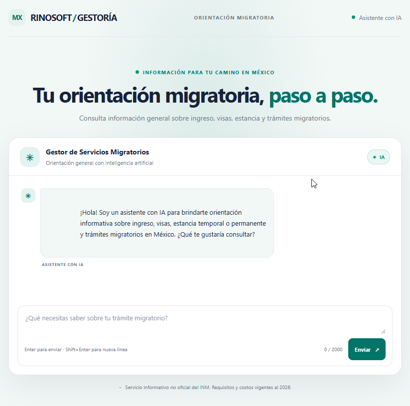 
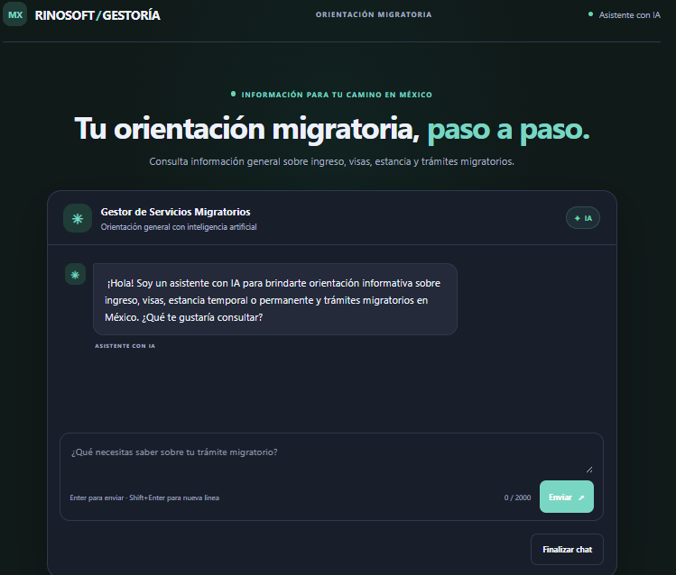

---

## 1. El problema

- **¿Quién tiene el problema?** Rinosoft, una empresa de gestoría de servicios migratorios en México requiere una forma más ágil y sencilla de brindar asesoría y prestar sus servicios. La normatividad en la materia es muy extensa y se encuentra dispersa en leyes, reglamentos y lineamientos que se actualizan con frecuencia, lo que vuelve lento, complejo y poco práctico localizar la información vigente y aplicable a cada caso.

## 2. La solución

Un chatbot web, impulsado por un agente de Microsoft Foundry, que brinda orientación informativa sobre ingreso a México, visas, estancia temporal o permanente y trámites del Instituto Nacional de Migración (INM). Puede orientar sobre requisitos y documentos, y solo debe proporcionar importes cuando pueda respaldarlos con información oficial vigente. Mantiene el contexto entre mensajes.

No debe solicitar datos sensibles. Confirma siempre los requisitos y costos con las fuentes oficiales correspondientes ya cargadas en el conocimiento de la IA.

Finaliza con un documento editable y entregable al cliente.

**Qué puede hacer el usuario:**

1. Escribir una pregunta y recibir una respuesta en segundos.
2. Continuar la conversación (el agente recuerda lo anterior).
3. Recibir un documento editable y entregable para el cliente.

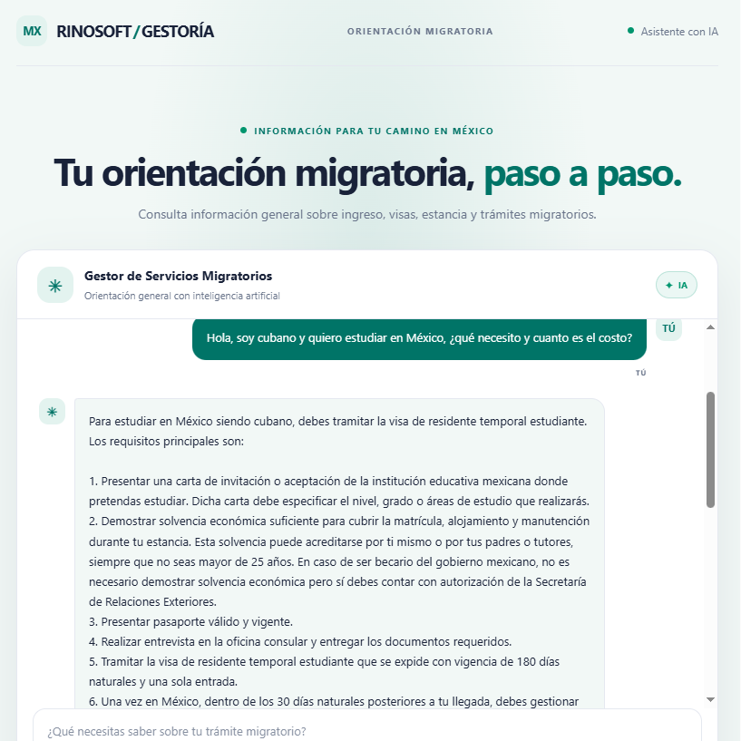

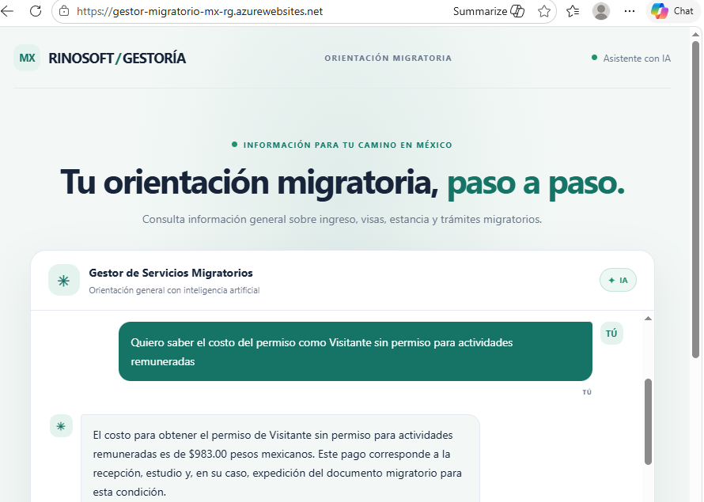

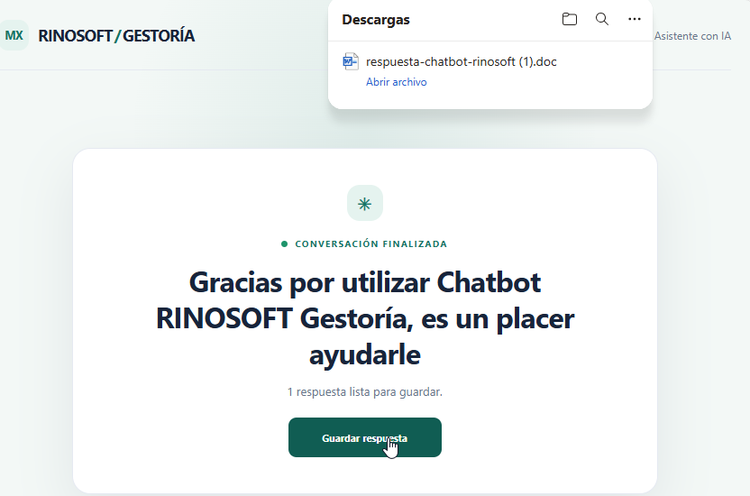

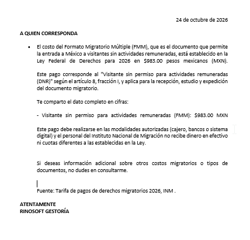

## 3. Arquitectura

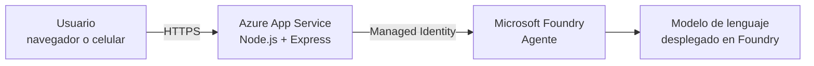

**Flujo:** el navegador envía el mensaje a `POST /api/chat`; el backend valida la entrada, llama al agente de Foundry con la conversación activa y devuelve la respuesta. El navegador nunca habla directo con Foundry.

### Servicios de Azure usados y por qué

| Servicio | Para qué se usa | Por qué es la opción adecuada (costo / simplicidad) |
|----------|-----------------|------------------------------------------------------|
| Microsoft Foundry (proyecto + agente) | Orquestar el agente y el modelo | _Un solo lugar para modelo, instrucciones y agente; sin infraestructura propia_ |
| Modelo desplegado (ej. gpt-4.1-mini) | Generar las respuestas | _Bajo costo por token, suficiente para el caso_ |
| Azure App Service (Linux, Node 24) | Hospedar frontend y backend | _Una URL pública sin administrar servidores_ |
| Managed Identity | Autenticar el backend contra Foundry | _Sin llaves en el código_ |

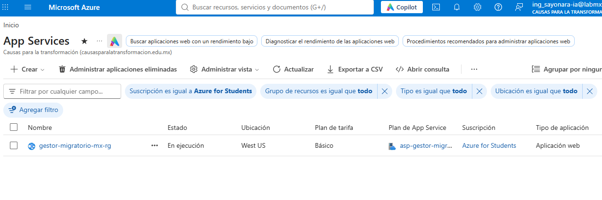

## 4. Cómo está construido

- **Frontend:** HTML, CSS y JavaScript sin frameworks (`public/`).
- **Backend:** Node.js 24 + Express 5, ES Modules.
- **SDK:** `@azure/ai-projects` 2.x con `DefaultAzureCredential`.
- **Agente:** requiere `FOUNDRY_PROJECT_ENDPOINT`, `FOUNDRY_AGENT_NAME` y `FOUNDRY_MODEL_DEPLOYMENT_NAME`.
- **API:**

| Endpoint | Descripción |
|----------|-------------|
| `POST /api/chat` | Recibe `{ message, conversation_id? }` y devuelve `{ reply, conversation_id }` |
| `GET /health` | Devuelve `{ "status": "ok" }` |

- **Validación:** el mensaje debe tener entre 1 y 2000 caracteres (si no, responde 422). Si Foundry falla, responde 502 con un mensaje genérico.

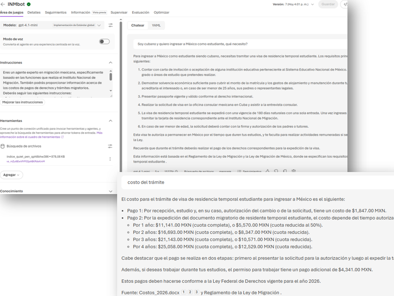

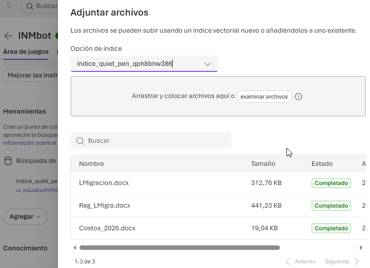

- **Límite de protección del agente INMbot de Foundry** contra palabras obscenas, filtración de datos confidenciales, seguridad del contenido, etc.

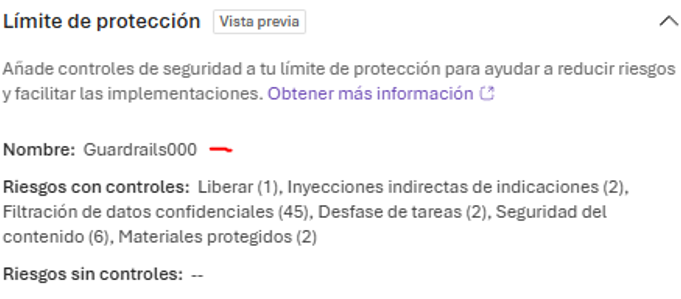

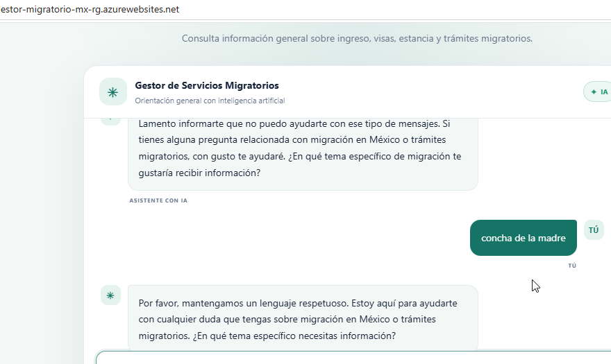

## 5. Limitaciones y mejoras futuras

- _No hay login ni límite de uso por usuario (aceptable para el prototipo)._
- _La vigencia de las respuestas depende de las instrucciones y fuentes oficiales disponibles para el agente; los requisitos e importes deben confirmarse en las fuentes oficiales, en caso de alguna actualización, antes de tomar decisiones._
- _Mejora posible: voz con Azure AI Speech, no consideré implementarla ya que resultan un poco extensas las respuestas, pero podría funcionar_

## 6. Conclusión

El proyecto resuelve el problema planteado: el usuario obtiene respuestas rápidas y en lenguaje sencillo, basadas en las leyes y reglamentos cargados en el agente, sin tener que buscar manualmente en documentos extensos. Obtiene al finalizar un documento que puede editar y entregar al cliente con requisitos y costos del trámite a realizar.
Con esto se resuelve el problema de Atención al Cliente, planteado en la Fase 1 del proyecto.

**Qué se practicó**
- **IA generativa y agentes:** creación de un agente en Microsoft Foundry con instrucciones precisas, herramientas, conocimiento y límites definidos sobre lo que puede y no puede responder.
- **Integración:** conexión del agente con un backend en Node.js mediante el SDK `@azure/ai-projects`, sin exponer llaves ni permitir que el navegador hable directo con Foundry.
- **Despliegue en Azure:** publicación de la aplicación web en Azure App Service con identidad administrada, accesible desde una URL pública.
- **IA responsable:** aviso visible de que se habla con una IA, manejo de errores y diseño accesible desde el celular.
- **Uso de IA como apoyo al desarrollo:** agentes de código para planear, construir y desplegar con cambios pequeños y verificables.
